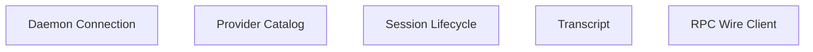
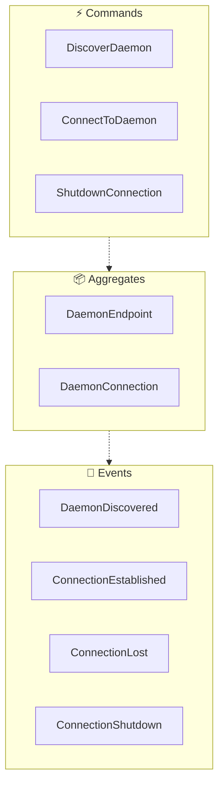
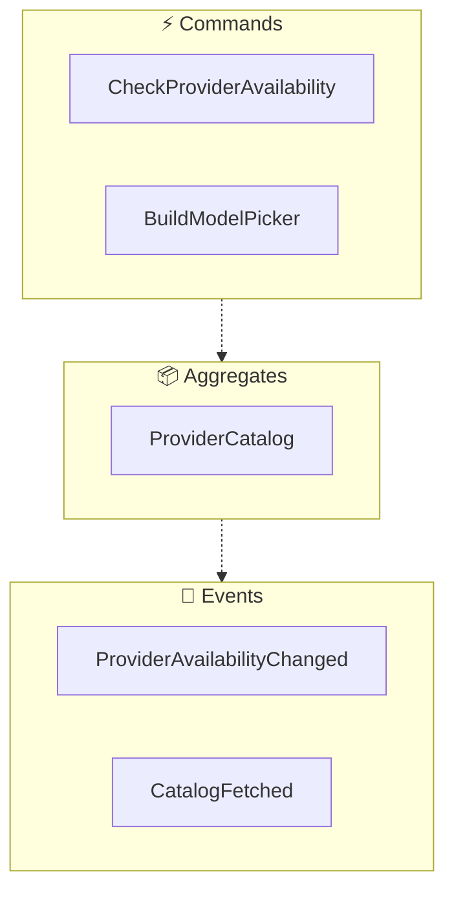
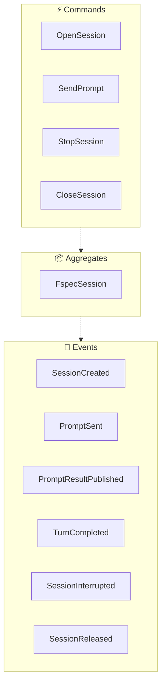
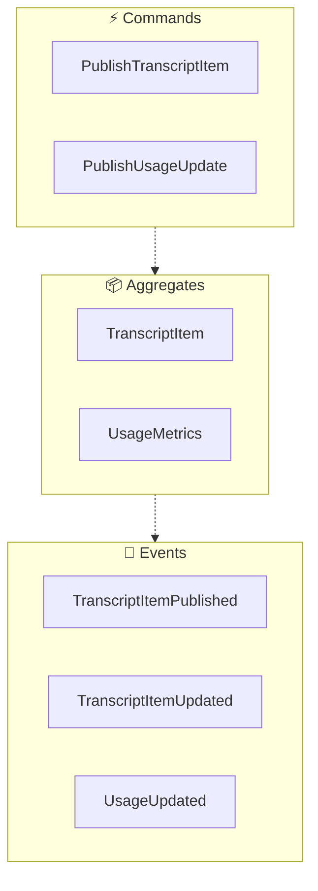
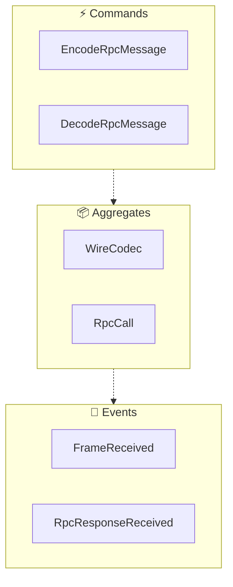

<!-- THIS FILE IS AUTO-GENERATED FROM spec/foundation.json -->
<!-- DO NOT EDIT THIS FILE DIRECTLY -->
<!-- Edit spec/foundation.json and run: fspec generate-foundation-md -->

# fspec-paseo Project Foundation

## Vision

Give Paseo users one place to drive their fspec work: a Paseo provider plugin that attaches to a running fspec daemon as a real client over the fspec RPC protocol, so an fspec agent session appears in Paseo as a normal agent with live streaming, models, and interruption.

---

## Problem Space

### fspec sessions are invisible outside the fspec TUI

A developer who runs fspec for spec-driven work (work units, Gherkin scenarios, the ACDD pipeline) and Paseo for agent orchestration has to live in two windows. fspec's agent sessions only speak to the fspec TUI: the daemon already hosts every session and serves many clients over its WebSocket RPC protocol, but the only clients that exist are fspec's own TUI, the NAPI frontend, and the `fspec client --mcp` stdio bridge. Paseo has no way to attach. So the developer cannot start an fspec session from Paseo's agent form, cannot watch its streaming output, tool calls, thinking, or token usage in Paseo's timeline, cannot interrupt it from Paseo, and cannot compare it side by side with the Claude, Codex, or Copilot agents they run there. Every switch costs context: the board, the running session, and the transcript are all in the other window. The missing piece is not a new agent runtime; fspec already has one. It is a Paseo provider plugin that behaves like any other Paseo provider while acting as an ordinary client of the fspec daemon.

**Impact:** high

---

## Solution Space

### Overview

A Paseo provider plugin that registers one provider ("fspec") and, for every Paseo agent, opens a session on an already-running fspec daemon instead of spawning a new agent runtime. The plugin is a real client of the daemon: it speaks the internal fspec RPC protocol directly (bincode 1.x-encoded tarpc 0.34 messages carried in the daemon's WebSocket envelope frames), discovers the daemon through `daemon.json` or an explicit connect URL, and consumes the daemon's server-pushed frames (stream chunks, session status, session lifecycle, work-unit snapshots) as the live source of truth. Paseo's provider contract and the daemon's RPC surface are mapped one to one: the daemon's provider/model/thinking catalog becomes Paseo's model picker; `create_session` plus `send_input` plus the pushed chunk stream become Paseo's session open, prompt, turn lifecycle, and timeline; `interrupt` becomes Stop. Nothing is re-implemented in the middle: no second agent loop, no polling of the daemon, no fspec CLI subprocess. The plugin owns only the translation between the two contracts plus the connection lifecycle, and it keeps the wire codec in one small audited module so the protocol stays traceable to the Rust source that defines it.

### Capabilities

- **fspec daemon connection**: Discover and attach to a running fspec daemon as a client: daemon.json autodiscovery, an explicit connect URL from provider configuration, loopback-only enforcement, and a clean shutdown of the connection when Paseo unloads the plugin.
- **fspec provider catalog in Paseo**: Present fspec as a selectable Paseo provider: report availability with a useful diagnostic when no daemon is reachable, and build Paseo's model picker from the daemon's provider and model catalog (list_providers, model entries, thinking levels) with defaults.
- **fspec session lifecycle from Paseo**: Open, drive, and stop an fspec session from Paseo: create the daemon session on session.open, send prompts with send_input, publish exactly one prompt result and one terminal turn event per prompt, interrupt the running session from Paseo's Stop, and release the session on close and on connection teardown.
- **Live fspec transcript in Paseo**: Turn the daemon's pushed stream chunks into Paseo timeline snapshots: assistant text, reasoning, tool calls with their results and progress, notifications, errors, and compaction, plus token and context usage, each published as a complete updatable item so Paseo derives the live delta.
- **fspec RPC wire client**: Encode and decode the fspec wire format in TypeScript: bincode 1.3.3 free-function config (little-endian, FIXED-WIDTH integers — u8/u16/u32/u64/u128 = 1/2/4/8/16 LE bytes, NOT varint; u64-LE length prefixes for String/Vec/bytes; u32-LE enum variant indices; 1-byte Option tag), the Envelope framing (9 variants, index 0..8), and tarpc 0.34 ClientMessage/Response framing (Request{context,id,message}; Response{request_id,message:Result}; 12-byte relative-deadline + 16-byte LE trace id + 8-byte span id + 4-byte sampling decision context), so the plugin can call the daemon's FspecService methods and read its pushed frames. Wire layout validated against Rust-generated golden vectors.

---

## Personas

### Spec-driven developer

Runs fspec in a workspace for work-unit and Gherkin-driven work and keeps Paseo open as the place where coding agents are launched, watched, and compared.

**Goals:**
- Start and steer an fspec agent session from Paseo without switching to the fspec TUI
- Watch fspec output, tool calls, and token usage live in Paseo's timeline
- Interrupt or stop a running fspec session from Paseo
- Run fspec side by side with Claude, Codex, or Copilot agents in one place

---

# Domain Architecture

## Bounded Contexts

- Daemon Connection
- Provider Catalog
- Session Lifecycle
- Transcript
- RPC Wire Client

## Bounded Context Map

## Daemon Connection Context

### Event Flow

**Aggregates:**
- DaemonEndpoint
- DaemonConnection

**Domain Events:**
- DaemonDiscovered
- ConnectionEstablished
- ConnectionLost
- ConnectionShutdown

**Commands:**
- DiscoverDaemon
- ConnectToDaemon
- ShutdownConnection

## Provider Catalog Context

### Event Flow

**Aggregates:**
- ProviderCatalog

**Domain Events:**
- ProviderAvailabilityChanged
- CatalogFetched

**Commands:**
- CheckProviderAvailability
- BuildModelPicker

## Session Lifecycle Context

### Event Flow

**Aggregates:**
- FspecSession

**Domain Events:**
- SessionCreated
- PromptSent
- PromptResultPublished
- TurnCompleted
- SessionInterrupted
- SessionReleased

**Commands:**
- OpenSession
- SendPrompt
- StopSession
- CloseSession

## Transcript Context

### Event Flow

**Aggregates:**
- TranscriptItem
- UsageMetrics

**Domain Events:**
- TranscriptItemPublished
- TranscriptItemUpdated
- UsageUpdated

**Commands:**
- PublishTranscriptItem
- PublishUsageUpdate

## RPC Wire Client Context

### Event Flow

**Aggregates:**
- WireCodec
- RpcCall

**Domain Events:**
- FrameReceived
- RpcResponseReceived

**Commands:**
- EncodeRpcMessage
- DecodeRpcMessage

---
